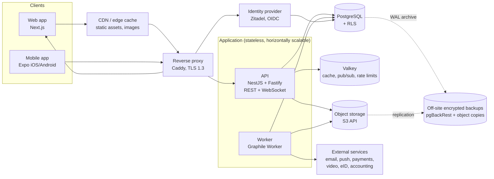

# Architecture

Decisions behind this document are recorded in [`adr/`](adr/). This document is
the current picture. When it changes, update it in the same PR as the ADR.

## Overview

## Components

| Component | Technology | Responsibility |
|---|---|---|
| Web | Next.js (App Router, React Server Components), TanStack Query | Member and admin UI, public club pages, backend-for-frontend (holds the session cookie) |
| Mobile | Expo (React Native), Expo Router, TanStack Query with persisted cache | Member/leader app, push, offline read access |
| API | NestJS on Fastify, Zod, Drizzle | REST API (`/api/v1`), WebSocket gateway, authorization, business logic |
| Worker | Graphile Worker (jobs stored in Postgres) | Email, push, reminders, exports, report generation, image processing, scheduled jobs |
| Identity | Zitadel (OIDC) | Login, passkeys, MFA, social login, later eID (BankID/Freja) via OIDC broker |
| Database | PostgreSQL 17+ | System of record, RLS-based tenant isolation, full-text search |
| Cache / realtime | Valkey (BSD-3 Redis fork) | Permission cache, rate limiting, WebSocket fan-out between API instances |
| Object storage | Any S3-compatible service (hosted: provider's object storage; self-host: Garage or SeaweedFS) | Documents, images, attachments, exports |
| Reverse proxy | Caddy | TLS, HTTP/2 and HTTP/3, compression, security headers |
| Observability | OpenTelemetry → Prometheus/Loki/Tempo/Grafana; GlitchTip or Sentry for errors | Metrics, logs (without personal data), traces, alerts |

## Modular monolith

The API is **one deployable** split into modules with strict boundaries. Each
module owns its tables, exposes a service interface and publishes domain events
(in-process, persisted through an outbox table so the worker can react reliably).

Planned modules (see `roadmap.md` for order):

`identity` · `people` · `clubs` · `groups` (incl. waiting lists) · `memberships` · `authorization` (incl. person visibility) ·
`audit` (audit events + record history) · `privacy` (GDPR) · `notifications` · `activities` · `attendance` ·
`events` · `calendar` (iCal feeds, invitations) · `carpool` · `messaging` (email/board) · `chat` · `documents` ·
`clearances` (background checks) · `grants` (LOK-stöd, country packs) ·
`plans` (training plans/library) · `finance` (team cash desk, fees) ·
`sponsors` · `streaming` · `staff` (time/salary) · `billing` · `entitlements`

## Multi-tenancy

- Shared database, shared schema. Club-owned rows carry `club_id`.
- Every request runs inside a transaction that sets
  `SET LOCAL app.club_id = ...` and `SET LOCAL app.person_id = ...`.
  RLS policies use these settings. This is **defence in depth**: the
  authorization module is the primary check, RLS guarantees that a bug cannot
  leak another club's data.
- Global (non-club) tables: `people`, `accounts`, shared plan library,
  platform tables. Access to them goes through explicit policies.
- The application connects as a role **without** `BYPASSRLS`. Migrations run as
  a separate owner role. Platform operator tooling uses a third role, audited.
- Transaction-scoped settings (`SET LOCAL`) keep this compatible with PgBouncer
  in transaction pooling mode.

## Authentication

- Zitadel is the OIDC provider. The app never sees passwords.
- **Web:** Next.js acts as backend-for-frontend. Authorization-code flow with
  PKCE; tokens stay server-side; the browser holds only an `HttpOnly`, `Secure`,
  `SameSite=Lax` session cookie. No tokens in `localStorage`.
- **Mobile:** authorization-code flow with PKCE via the system browser; refresh
  token in the OS secure store (Keychain/Keystore).
- **API:** validates access tokens (JWT, cached JWKS), maps the subject to a
  `person`. Short-lived access tokens (≤ 10 min), rotating refresh tokens.
- MFA (passkey or TOTP) is **required** for roles with elevated access: board,
  club manager, treasurer, anyone who can see background-check status or
  personal identity numbers.
- Development: a `DEV_AUTH` provider lets you log in as any seeded persona
  without Zitadel. It refuses to start unless `NODE_ENV=development`
  (see `seed-data.md`).

## Authorization

In-process, relationship-based (ReBAC) policy engine in the `authorization`
module. See [ADR 0006](adr/0006-authorization.md).

- Permissions are derived from relationships: *membership in club*, *role in
  club* (board, manager, treasurer…), *owner of group*, *function in group* (member, coach,
  manager), *guardian of person*, *employee of club*.
- Each endpoint declares a permission such as `activity.attendance.write` on a
  resource; the policy resolves it from the relationships.
- The relationship set for a person is loaded once per request (one query) and
  cached in Valkey with versioned invalidation on membership/role changes.
- Guardians act **on behalf of** a child: the API records both the actor and the
  subject in audit events.

## Person visibility (protected identity)

Any response, export, notification, feed or history view that mentions a
person passes through the `PersonVisibility` service (ADR 0022), which returns
*full*, *full with protected icon* or *hidden* for each person, computed in
bulk per request from cached data. Repositories return person IDs; presenters
resolve names. This is enforced by lint rules and tests.

## API style

- REST + JSON, OpenAPI 3.1 generated from Zod schemas. Typed client generated into
  `packages/api-client` and used by web and mobile.
- Keyset (cursor) pagination, `fields`/`include` parameters to avoid
  over-fetching, ETags + `If-None-Match` on reads.
- Realtime: one WebSocket per client; server pushes *invalidation events*
  ("activity 123 changed") and chat messages. Clients refetch through REST.
- Public API for integrations (federations, accounting) uses the same
  endpoints with OAuth client credentials and scoped API keys per club.

## Country packs

Country-specific rules live in `packages/country-packs/<cc>/` behind interfaces:

- background-check types and validity rules (SE: belastningsregisterutdrag;
  NO: politiattest; UK: DBS; DE: erweitertes Führungszeugnis),
- activity grant rules and export formats (SE: LOK-stöd → IdrottOnline),
- personal identity number formats and validation,
- default locale, time zone, currency, public holidays.

The core never branches on country code; it asks the club's country pack.

## Locale

- Club has `country`, `default_locale`, `time_zone`, `currency`.
- Person has optional `locale` and `time_zone` overrides; fallback chain:
  person → club in current context → browser/device → `en`.
- Times stored UTC; activities displayed in the club's time zone (with the
  viewer's zone shown when it differs).

## Deployment

- All services ship as OCI images built in CI, signed, with SBOMs.
- **Self-hosting:** `infra/docker/compose.yml` brings up everything
  (Caddy, web, api, worker, Postgres, Valkey, Zitadel, object storage, backup
  sidecar). One `.env` file. See `hosting-and-billing.md`.
- **Hosted service:** same images, EU-only providers, managed or replicated
  Postgres, two availability zones for app nodes, off-site backups with a
  different provider. Orchestrated with Docker Compose/Swarm initially;
  Kubernetes only when scale requires it.

## External integrations (pluggable providers)

| Capability | Interface | First implementations |
|---|---|---|
| Email | `MailProvider` | SMTP (self-host), EU transactional provider (hosted) |
| Inbound email (calendar replies) | `InboundMailProvider` | Provider webhook (hosted), IMAP/LMTP mailbox (self-host) |
| Push | `PushProvider` | Expo Push, direct APNs/FCM |
| Payments | `PaymentProvider` | Stripe (cards), Swish (SE) |
| Video | `StreamingProvider` | api.video / Mux, self-hosted MediaMTX |
| eID | OIDC via Zitadel | Criipto/Signicat broker for BankID/Freja |
| Accounting | `AccountingExport` | SIE file export, Fortnox API |
| Federation | `FederationExport` | IdrottOnline (LOK, members) |
