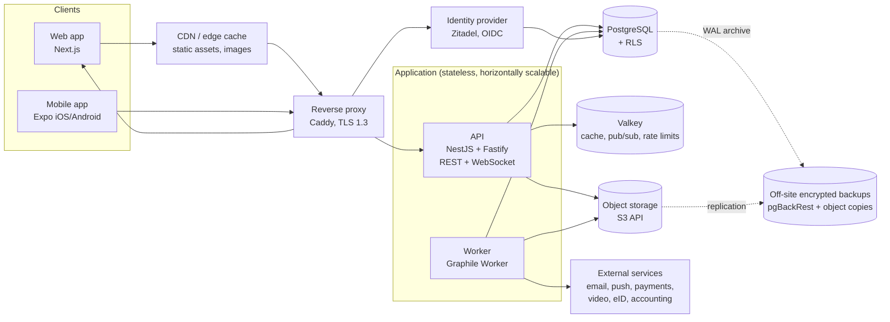

# Architecture

Decisions behind this document are recorded in [`adr/`](adr/). This document is
the current picture. When it changes, update it in the same PR as the ADR.

## Overview



## Components

| Component | Technology | Responsibility |
|---|---|---|
| Web | Next.js (App Router, React Server Components), TanStack Query | Member and admin UI, public club pages, backend-for-frontend (holds the session cookie) |
| Mobile | Expo (React Native), Expo Router, TanStack Query with persisted cache | Member/leader app, push, offline read access |
| API | NestJS on Fastify, Zod, Drizzle | REST API (`/api/v1`), WebSocket gateway, authorization, business logic |
| Worker | Graphile Worker (jobs stored in Postgres) | Email, push, reminders, exports, report generation, image processing, scheduled jobs |
| Identity | Zitadel (OIDC) | Login, passkeys, MFA, social login, later eID (BankID/Freja) via OIDC broker |
| Database | PostgreSQL 18+ (built-in `uuidv7()`), Drizzle ORM | System of record, RLS-based tenant isolation, full-text search |
| Cache / realtime | Valkey (BSD-3 Redis fork) | Permission cache, rate limiting, WebSocket fan-out between API instances |
| Object storage | Any S3-compatible service (hosted: provider's object storage; self-host: Garage or SeaweedFS) | Documents, images, attachments, exports |
| Reverse proxy | Caddy | TLS, HTTP/2 and HTTP/3, compression, security headers |
| Observability | OpenTelemetry → Prometheus/Loki/Tempo/Grafana; GlitchTip or Sentry for errors | Metrics, logs (without personal data), traces, alerts |

## Modular monolith

The API is **one deployable** split into modules with strict boundaries. Each
module owns its tables, exposes a service interface and publishes domain events
(in-process, persisted through an outbox table so the worker can react reliably).

Built so far (P0.5, `apps/api/src/modules/`, no HTTP endpoints yet; wired in
`src/domain.module.ts`):

| Module | Owns | Notes |
|---|---|---|
| `people` | `people` | Create (no email), update, global protected identity (self or full guardian), encrypted personal identity number |
| `person-merge` | `people_merges` | Merge duplicates with 30-day undo; moves the references each module declares in its `*.references.ts` |
| `accounts` | `accounts` | Account for a verified email, change email, "give own login" (from `own_account_min_age`) |
| `clubs` | `clubs` | Settings, `join_policy` |
| `onboarding` | `club_creation_requests` | Profile completion, club creation per `CLUB_CREATION` (creator becomes active member #1 and club manager; or a request operators decide), club managers: appoint, remove, hand over, chair claim, operator reassignment (P1.1) |
| `joining` | `join_requests`, `invitations`, `invitation_acceptances` | Club search, join requests (the only record of an application), email/link/code invitations with presets (P1.1, ADR 0032) |
| `roles` | `club_role_assignments`, `club_manager_handovers`, `club_manager_reassignments` | Roles, last-manager rule, hand-over (propose, accept, decline, cancel) |
| `club-profiles` | `club_profiles` | Member number, shared fields, club-level protected identity (managers only) |
| `groups` | `groups`, `group_owners`, `seasons`, `group_seasons` | Hierarchy, archive, owners (`allowedBy: club_manager \| group_owner`) |
| `memberships` | `club_memberships`, `group_memberships` | Join an open club, add, leave, group functions, "my clubs and groups" |
| `guardianships` | `guardianships`, `guardian_invitations` | Add child, invite and accept co-guardian, rights, ending rules |
| `authorization` | `platform_operators`, `support_access_grants` (reads all relationship tables) | Relationship sets, policies, resource loaders, `PersonVisibility`, `PersonPresenter`, profile field filtering (P0.7, ADR 0025) |
| `person-profiles` | — | `GET /people/:personId`: person, club profile and guardians, filtered per relationship |
| `members` | `member_exports`, `member_imports`, `member_import_rows` (reads the register view `app.register_entries`) | The member register: search, filters, facets, field sets per register access (`RegisterPresenter`), membership changes through `memberships`, exports (P1.2); adding members by hand and importing them from CSV through `people`, `memberships`, `groups`, `guardianships` and `accounts` (P1.3b, ADR 0033) |

Read endpoints (P0.7, extended for the web shell in P0.9): `GET /api/v1/me`
(with the account's `preferences`: language, time zone, theme),
`/me/clubs` (with each club's language, time zone and the caller's club-level
permissions), `/me/groups` (the caller's and their wards' groups with
functions), `/me/wards` (own data), `PATCH /me/preferences`,
`/clubs/:clubId` (with the club managers) and `/clubs/:clubId/groups`
(`club.read`), `/groups/:groupId` (with the owners; `group.read`),
`/groups/:groupId/members` (`group.members.read`, keyset pagination by name,
total count as aggregate), `/people/:personId?clubId=`
(`person.profile.read`). People in them are `PersonSummary`s from the
`PersonPresenter`. Lists page with `cursor` (the last item's ID, never data)
and `limit`.

Services take an `ActorContext` or `TenantContext` and open their own
transaction; `…InTx(tx, …)` variants let another module's service join it.
Expected failures are `DomainError`s with a stable code (`last_club_manager`,
`email_taken`, …) that map to problem types; they never carry values or
database errors. Tables waiting for their flows (`group_waitlist_entries`,
`join_requests`, `invitations`, `employments`, `consents`) exist with stable
names.

Planned modules (see `roadmap.md` for order):

`identity` · `people` · `clubs` · `groups` (incl. waiting lists) · `memberships` · `authorization` (incl. person visibility) ·
`audit` (audit events + record history) · `privacy` (GDPR) · `notifications` · `activities` · `attendance` ·
`events` · `calendar` (iCal feeds, invitations) · `carpool` · `messaging` (email/board) · `chat` · `documents` ·
`clearances` (background checks) · `grants` (LOK-stöd, country packs) ·
`plans` (training plans/library) · `finance` (team cash desk, fees) ·
`sponsors` · `streaming` · `staff` (time/salary) · `billing` · `entitlements`

## Multi-tenancy

- Shared database, shared schema. Club-owned rows carry `club_id`.
- Defence in depth: the authorization module is the primary check; row-level
  security (RLS) guarantees that a bug cannot leak another club's data.
- Global (non-club) tables: `people`, `accounts`, `guardianships`, shared
  plan library, platform tables. They have RLS too: a person reaches only
  themselves, their family and, in a club transaction, that club's members
  ([ADR 0023](adr/0023-global-tables-rls.md)).
- A person's own relationships (and their wards') are readable across clubs
  for "my clubs and groups"; writes are always limited to one club.

## Database (`packages/db`)

### Roles

| Role | Used by | Can |
|---|---|---|
| `clubadmin_owner` | `pnpm db:migrate` | Owns schemas and tables; runs DDL. Never used by the apps. |
| `clubadmin_app` | API, worker | DML on application tables, subject to RLS; insert-only on audit; read-only on history; no DDL, no `BYPASSRLS`. |
| `clubadmin_operator` | operator tooling | Like the app role, but every change must identify an operator (`app.actor_kind = 'operator'`), or it is rejected. |
| `clubadmin_retention` | retention and erasure jobs | May delete or scrub history and audit rows, across clubs. |

`pnpm db:bootstrap` (superuser, idempotent) creates them from
`packages/db/sql/roles.sql` and sets passwords from `DB_*_PASSWORD`;
`pnpm db:migrate` applies the migrations as the owner. `pnpm dev:services`
runs both.

### Transactions and context

All database access goes through three functions of `createDatabase(...)`:

| Function | For | Settings |
|---|---|---|
| `db.withTenant(ctx, tx => …)` | Club data | `app.club_id`, `app.person_id`, `app.on_behalf_of`, `app.request_id`, `app.actor_kind`, `app.ip_hash` |
| `db.withActor(ctx, tx => …)` | Global tables (people, accounts) | same, without club |
| `db.withSystem(jobName, { clubId? }, tx => …)` | Worker jobs | `actor_kind = system_job`, `request_id = job:<name>` |

Each call is one transaction. `BEGIN` and the settings (`set_config(..., true)`,
transaction-local) go in a single round trip, so it works with PgBouncer
transaction pooling. The overhead is about 0.6 ms per transaction. The raw pool
is internal to `packages/db` (dependency-cruiser enforces it). SQL reads the
context through `app.current_club_id()`, `app.current_person_id()`,
`app.current_on_behalf_of()`, `app.current_actor_kind()` and
`app.current_request_id()`, which return NULL when unset.

### Migrations

- `packages/db/migrations/NNNN_name.sql`, applied in order, each in its own
  transaction, recorded with a checksum in `app_meta.schema_migrations`.
  Editing an applied migration stops `db:migrate` and fails `/health/ready`.
- Application tables are defined with Drizzle in `packages/db/src/schema/`;
  `pnpm db:generate` writes the migration. Infrastructure schemas (`app`,
  `history`, `audit`, `outbox`, `privacy`, `app_meta`) are hand-written SQL.
- Every new club-owned table calls, in its migration:

  ```sql
  SELECT app.enable_tenant_rls('public.groups');   -- RLS on club_id, enabled and forced
  SELECT app.enable_updated_at('public.groups');   -- keeps updated_at current
  SELECT history.enable_history('public.groups');  -- record history (ADR 0017)
  -- options: redact => ARRAY['personal_identity_number'], skip_insert => true
  ```

  Integration tests (`findGuardViolations`) fail if a table misses one of
  them; exclusions are listed with a reason in `src/history-exclusions.ts`.
- `pnpm lint` warns about unsafe statements (dropping or renaming columns,
  type changes) unless marked `-- expand-contract: <reason>`.

### History, audit, outbox

- **Record history:** statement-level triggers (`history.capture()`, using
  transition tables) write one row per changed record to the monthly-partitioned
  `history.record_changes`: changed columns only, old/new values, actor,
  on-behalf-of, request ID, transaction, database role. Changes without context
  are recorded as `actor_kind = db_role`. The worker job
  `history:maintain_partitions` creates partitions ahead and drops expired ones.
  Read with `getRecordHistory(tx, table, id, { cursor })`.
- **Audit events:** `audit.record(tx, { action, resourceType, resourceId, changedFields })`
  in the same transaction; actions are registered in
  `packages/shared/src/audit-actions.ts`.
- **Outbox:** `outbox.publish(tx, type, payload)` writes a domain event
  (`packages/shared/src/domain-events.ts`, IDs only). A trigger enqueues the
  `outbox:dispatch` job in the same transaction, so rolled-back events are never
  dispatched. Handlers (`apps/worker/src/outbox-handlers.ts`) run at most once
  per event: their database work and the delivery record commit together.
  Failures retry with backoff (10 attempts), then the event is marked `failed`
  and an error is logged.
- **Deletion ledger:** `privacy.deletion_ledger` (erased person IDs), re-applied
  after restores with `privacy.replay_deletion_ledger`, which runs the erasure
  core `privacy.erase_person` for every entry (ADR 0030).
- **Backups (`ops` schema):** `ops.backup_runs` and `ops.restore_verifications`,
  written by the backup tooling (superuser), readable by the app role for
  `GET /api/v1/ops/backup-status`; no personal data, no history trigger.
  Tooling: `infra/backup/` (PostgreSQL image with pgBackRest, the backup
  sidecar) and `packages/ops` (`pnpm ops:*`), see
  docs/operations/backup-restore.md.

### Core domain tables (P0.5)

Columns are in [domain-model.md](domain-model.md); the schema is in
`packages/db/src/schema/` (`people.ts`, `clubs.ts`, `groups.ts`,
`joining.ts`), the hand-written part of the migration in
`migrations/0001_core_domain.sql`. Database-enforced invariants:

| Invariant | How |
|---|---|
| At least one active club manager per club | Deferred constraint triggers `club_has_manager_*` (checked at commit after locking the club row, so concurrent removals cannot both pass) |
| Member numbers unique per club | `assign_member_number` trigger takes `clubs.next_member_number` under the club row's lock; unique `(club_id, member_number)` |
| Group parent in the same club, no cycles | Composite foreign key `(club_id, parent_group_id)`; `check_group_cycle` trigger with a per-club advisory lock |
| Every reference to a group is in the same club | Composite foreign keys `(club_id, group_id)` on memberships, owners, seasons, waiting lists, invitations |
| Login email unique case-insensitively, people have no email | Unique index on `lower(btrim(email))` on `accounts`; no email column on `people` |
| Protected persons have no address | Check constraint `people_protected_no_address` |
| One open relationship per kind | Partial unique indexes `WHERE valid_to IS NULL` |
| Relationships are never deleted | `DELETE` revoked from the app role on people, clubs, memberships, roles, guardianships, groups, owners |

`clubs.next_member_number` is an *ignored* history column
(`history.enable_history(..., ignore => ...)`), so assigning numbers does not
fill the club's history.

Field encryption: `crypto.data_keys` holds data keys wrapped by the master
keys from `ENCRYPTION_MASTER_KEYS` (never in the database); one key per club
plus a global key for global tables. `people.personal_identity_number` is
ciphertext (AES-256-GCM, bound to the row), `personal_identity_number_hash`
a blind index (HMAC with `BLIND_INDEX_KEY`) for finding duplicates. Helpers:
`@clubadmin/server-kit/crypto`, used through `FieldEncryption` in the API.

### Tests

`pnpm test:integration` runs against the local PostgreSQL. A template
database is migrated once (rebuilt only when migrations change); each test
file clones it (`createTestDatabase()`, about 0.1 s). Helpers:
`createTestClubs`, `asPerson`, `expectTenantIsolation`.

## Authentication

- Zitadel is the OIDC provider (ADR 0005); the app never sees passwords. Its
  configuration is code: `pnpm auth:configure` (also run by `pnpm
  dev:services`) applies `infra/zitadel/clubadmin.json` — project
  `clubadmin`, apps `web` (confidential, code + PKCE), `mobile` (native,
  PKCE) and `api`, login and password policies, lockout, token lifetimes,
  branding, Swedish and English texts — and writes the client IDs to
  `.env.local` (`--print` for operators). Login pages: Zitadel's built-in
  login UI (v1) under `https://auth.clubadmin.localhost/ui/login`.
- **API** (`apps/api/src/modules/identity`): a global `AuthGuard` validates
  `Authorization: Bearer` access tokens with `jose` (issuer, audience = the
  Zitadel project, expiry, signature through a cached JWKS that is refetched on
  an unknown `kid` at most once a minute) and the ID token in `X-Id-Token`,
  bound to it by `at_hash` (ADR 0024). The **principal** is
  `{ accountId, personId, mfa, authTime, sessionId }`; `mfa` comes from `amr`.
  Mapping subject → account is cached in memory for 5 minutes, so a request
  needs no database query (validation p95 < 1 ms).
- **Endpoint access** in `@Endpoint`: `{ public: true }`, `{ authenticated:
  true }` (the person's own data) or `{ permission, resource }` (checked by
  the authorization module, below). `@RequireMfa()` answers `403 mfa-required` without a second factor;
  `@RecentAuth(minutes)` answers `403 reauthentication-required`.
- **Provisioning:** the first request with an unknown subject creates person
  and account from the ID token's verified email and names. An email that
  already belongs to another account (in any letter case) is refused with
  `409 conflict` / `email_taken`: accounts are never merged by email. A
  verified email that changed in Zitadel is taken over on the next login.
  With a "give own login" invitation (`X-ClubAdmin-Invitation`, ADR 0020) the
  new login is linked to the invited person instead. At most 10 first logins
  per client IP and minute (Valkey, shared by all instances; refused while
  Valkey is unreachable).
- **Web (BFF, `apps/web`):** Next.js route handlers `/auth/login/start`,
  `/auth/callback`, `/auth/logout` (and `/auth/dev-login`) do authorization
  code + PKCE with `openid-client`. Tokens stay in Valkey, encrypted with
  `SESSION_ENCRYPTION_KEY` (AES-256-GCM, bound to the session ID); the browser
  holds only `__Host-session` (`HttpOnly; Secure; SameSite=Lax; Path=/`) and
  `__Host-csrf`. Browser calls to `/api/*` go through the BFF, which adds the
  tokens and refreshes them (rotation; a rejected refresh token ends the
  session). Non-GET requests need `X-CSRF-Token` equal to the CSRF cookie and
  the session's token, from the site's own origin. The login adds exactly one
  API call (`GET /api/v1/me`). `api.clubadmin.localhost` serves the API
  directly for clients with their own tokens (mobile).
- **Sessions:** `GET /api/v1/me/sessions` lists the person's sessions from an
  index in Valkey (by a public handle, never the session ID): browser sessions
  written by the BFF, and mobile app sessions the API registers on the first
  request of a Zitadel session from the mobile client (`azp` =
  `AUTH_MOBILE_CLIENT_ID`; device and app version from the `X-Client-*`
  headers, never a device identifier). `DELETE /api/v1/me/sessions/:id`
  removes the session (a browser is logged out on its next request) and ends
  the Zitadel session (machine user `clubadmin-api`, `ZITADEL_API_TOKEN`), so
  the app's refresh token stops working; its access token may live out its 10
  minutes.
- **Rate limits** (`docs/security.md`): per client IP for requests without a
  valid login (`@fastify/rate-limit`), per account in the `AuthGuard` once the
  token is verified (with a much higher per-IP backstop), and per club and
  account for `bulkRead` endpoints; counters in Valkey
  (`platform/http/rate-limiter.ts`).
- **Mobile** (P0.10, ADR 0028): authorization code with PKCE in the system
  browser for the native `mobile` client; refresh token in the OS secure
  store (Keychain/Keystore), access and ID tokens in memory. Development
  builds log in as personas with tokens from `POST /api/v1/dev/tokens`. A
  revoked app session is refused by the API (deny list), also with
  refreshed tokens.
- Short-lived access and ID tokens (10 min), rotating refresh tokens (30 days
  idle, 90 days at most).
- MFA (passkey or TOTP) is **required** for roles with elevated access: board,
  club manager, treasurer, anyone who can see background-check status or
  personal identity numbers (enforced with the permissions, P0.7).
- **Development:** with `DEV_AUTH=true` the login page shows a persona picker
  (`GET /api/v1/dev/personas`, only registered then); the BFF signs HS256
  tokens with `DEV_AUTH_KEY` (`iss = clubadmin-dev`,
  `@clubadmin/server-kit/dev-tokens`), and the API does the same for the
  mobile app (`POST /api/v1/dev/tokens`, no refresh token), for the chosen person,
  with or without MFA. API and web refuse to start with `DEV_AUTH=true` unless
  `NODE_ENV=development` and `DEPLOYMENT_MODE=self_hosted`, and log a warning
  on every start (see `seed-data.md`).

## Web app (`apps/web`, P0.9)

- **Rendering:** Next.js App Router with React Server Components; pages read
  the API on the server (`src/server/data.ts`: one request per resource and
  request, in parallel, validated with the shared Zod schemas; API 401 →
  login, 404 → the not-found page, 403 → the forbidden page). Client
  components only for interaction: the menus, the "Show more" of keyset lists
  (TanStack Query with the generated `@clubadmin/api-client`, through the
  BFF), the browser's time zone.
- **Shared UI** (`packages/ui`): design tokens as Tailwind CSS v4 theme
  variables (`tokens.css`, light and dark theme: the browser's preference or
  the account's), `PersonName` (the only way to show a name; it takes a
  `PersonSummary` and nothing with more fields; its text comes from
  `personLabel` in `packages/shared`, shared with the mobile app),
  `ProtectedBadge` (crossed camera, tooltip), `RoleBadge`, `ClubSwitcher`,
  `Menu` (Radix UI, loaded on first use), `DataList` (keyset pagination,
  virtualised above 200 rows), `DateTime`, `EmptyState`. Components take
  translated texts as props.
- **Frame:** club switcher (`GET /me/clubs`; the last club is remembered per
  person in Valkey, `web:last-club:<personId>`), main navigation (Home,
  Groups; Members only with `club.members.read`), "Viewing as" switcher for
  guardians with `act_on_behalf`, user menu (profile, account, language and
  time zone, sessions, log out), footer with the "Source code" link
  (`/api/v1/meta/source`, AGPL-3.0 section 13) and the version.
- **Viewing as:** the chosen ward is stored in the BFF session
  (`viewingAs`); the BFF sends it as `X-On-Behalf-Of` on every API call
  except the person's own account (`/me`, `/me/wards`, `/me/sessions`,
  `/me/preferences`) and public metadata. The browser cannot set the header;
  the API checks the right on every request (ADR 0006).
- **Pages:** `/login` (persona picker grouped by club with DEV_AUTH, "Log in
  with email"; `/auth/login` redirects there), `/` (my clubs, my groups, my
  children's groups; onboarding placeholder without a club), `/clubs/[id]`,
  `/clubs/[id]/groups` (tree), `/clubs/[id]/members` (placeholder until
  P1.2), `/groups/[id]`, `/people/[id]?clubId=`, `/me`, `/me/sessions`,
  `/me/preferences`. Activities (P1.4): `/schedule` ("My schedule", four
  weeks at a time, chips per person; the home page shows what is coming),
  the calendar on `/groups/[id]` with "New activity" and "New series" for
  those who manage it (`/groups/[id]/activities/new`,
  `/groups/[id]/series/new` with a preview), `/activities/[id]` (details,
  leaders; edit, cancel, restore, delete), `/activity-series/[id]` (rules,
  change from a date, "this and following"), `/clubs/[id]/calendar` and
  `/clubs/[id]/locations` (with double bookings). Times are entered in the
  club's time zone and converted with `zonedTime` (`packages/shared`).
- **Security:** CSP with a fresh nonce per request (`src/proxy.ts`),
  Trusted Types in production, no inline scripts, `frame-ancestors 'none'`,
  further headers in `next.config.ts` (ADR 0027). Production builds use
  webpack (`next build --webpack`; Turbopack has no Trusted Types policy).
- **i18n:** next-intl reads the ICU catalogues of `packages/i18n` (`sv`,
  `en` complete, `nb` falls back to `en` per message); see "Locale". The
  ESLint rule `clubadmin/no-jsx-literal-strings` forbids user-facing text in
  JSX, and `clubadmin/person-names-in-presenters` forbids name fields in the
  web app outside `PersonName`.

## Mobile app (`apps/mobile`, P0.10)

- **Stack** (ADR 0028): Expo SDK 57, React Native, Hermes, Expo Router
  (`src/app`), TanStack Query over the generated `@clubadmin/api-client`,
  use-intl with the catalogues of `packages/i18n`. No web packages
  (`packages/ui` is web-only; the app has its own `PersonName`,
  `ProtectedBadge`, `RoleBadge`, `DateTime`).
- **API calls** go directly to the API (`api.clubadmin.localhost` locally)
  with `Authorization`, `X-Id-Token`, `X-On-Behalf-Of` where
  `onBehalfApplies` (shared with the web BFF) says so, `Accept-Language` and
  `X-Client-Platform/Version/Device` (session list). A 401 triggers one
  refresh and one retry; a second 401 ends the login. 429 answers are
  retried after `Retry-After`.
- **Screens:** login (Zitadel, persona picker in development builds), "My
  schedule" (the start screen since P1.4: the coming four weeks of my and my
  wards' activities across clubs by day, chips per person, cancelled ones
  marked; offline from the persisted cache), activity (when, where with a
  map link, notes, leaders; the cached schedule entry before the details
  arrive), clubs and groups (my clubs with the club switcher, my groups, my
  children's groups, "viewing as"), club overview, groups tree, group (owners, leaders,
  members, keyset-paginated), profile, settings (language, time zone, theme,
  biometric unlock, sessions, about, logout), about (version, "Source code",
  licences). Deep links (`clubadmin://groups/<id>` and so on) accept UUIDs
  only.
- **Offline:** the query cache is persisted to MMKV, encrypted per account,
  and shown at once on start; requests pause while offline (NetInfo) and run
  when the app returns to the foreground. Data older than 15 minutes shows
  its age. Read-only: writes come with the outbox (P1.5).
- **Locale:** the same chains as the web: language from the user's
  preference, the current club, the device, English; time zone from the
  user, the club, the device.
- **Compatibility:** responses are used as the generated types describe
  them, never parsed strictly; unknown enum values show as "Other"
  (`enumKey`); `GET /meta/client` decides "update required/available" and
  which server features the app uses (ADR 0029). JavaScript updates through
  `expo-updates` (runtime version = native fingerprint).

## Authorization

In-process, relationship-based (ReBAC) policy engine in the `authorization`
module. See [ADR 0006](adr/0006-authorization.md).

- Permissions are derived from relationships: *membership in club*, *role in
  club* (board, manager, treasurer…), *owner of group*, *function in group* (member, coach,
  manager), *guardian of person*, *employee of club*, *support access* (operators).
- Each endpoint declares `access: { permission, resource }`, e.g.
  `{ permission: "group.members.read", resource: "group" }`. Permission names
  are in `packages/shared/src/permissions.ts`; there is exactly one policy per
  permission (`authorization.policy.ts`, `definePolicy(...)`, helpers such as
  `isClubManager`, `hasClubRole`, `ownsGroup` (incl. parent groups),
  `hasGroupFunction`, `isGuardianOf(personId, right)`, `isSelf`). The API
  refuses to start if a route has no `@Endpoint`, or an endpoint's permission
  has no policy, names another resource kind or lacks the path parameter.
- The `AuthGuard` builds the request's actor (`RequestAuthorization`, read
  with `@CurrentAuthorization()`), the resource loader reads the minimal scope
  (`:clubId`; `:groupId` with its club and ancestors; `:personId` with
  `?clubId`), and the policy decides. Denials: 404 without a relationship with
  the resource's club or for people, 403 otherwise (ADR 0025).
- The relationship set for a person is loaded once per request (one query) and
  cached in Valkey under a version key; the worker bumps versions on domain
  events (`authorizationCacheHandler`), so changes apply on the next request.
- Guardians act **on behalf of** a child with `X-On-Behalf-Of: <personId>`
  (needs `act_on_behalf`); the policy evaluates the child's memberships and
  the services record both the guardian (actor) and the child (on behalf of)
  in history and audit.

## Person visibility (protected identity)

Any response, export, notification, feed or history view that mentions a
person passes through the `PersonVisibility` service (ADR 0022), which returns
*full*, *full with protected icon* or *hidden* for each person, computed in
bulk per request from the relationship set and the club's cached protected
set. Repositories return person IDs; `PersonPresenter.present(viewer, clubId,
rows)` (in `modules/authorization/presenters/`) is the only code that turns
person rows into `PersonSummary` (hidden people left out; counts reported
separately) and `presentActors` masks hidden actors in history views as
`{ kind: "protected" }`. The lint rule `clubadmin/person-names-in-presenters`
forbids name fields and name columns elsewhere; the view
`app.visible_group_members` is the database backstop for rosters.

## API style

- REST + JSON, OpenAPI 3.1 generated from Zod schemas. Typed client generated into
  `packages/api-client` and used by web and mobile.
- Keyset (cursor) pagination, `fields`/`include` parameters to avoid
  over-fetching, ETags + `If-None-Match` on reads.
- Realtime: one WebSocket per client; server pushes *invalidation events*
  ("activity 123 changed") and chat messages. Clients refetch through REST.
- Public API for integrations (federations, accounting) uses the same
  endpoints with OAuth client credentials and scoped API keys per club.

## API implementation (`apps/api`)

| Concern | Where | Notes |
|---|---|---|
| Routes | `@Endpoint({ method, path, summary, access, request, response })` in `src/platform/http/endpoint.ts` | One declaration for route, Zod schemas (validation + OpenAPI), access rule and rate limit. A route declared with plain `@Get`/`@Post` makes the API refuse to start (`EndpointRegistry`). |
| Validation | `ValidationInterceptor` | Params, query and body parsed with the endpoint's schemas before the handler runs; responses parsed with the response schema, which strips undeclared fields. |
| Errors | `ProblemDetailsFilter`, `ProblemError` | Everything becomes RFC 9457 problem details ([problem types](api/problems.md)); titles translated from `Accept-Language`. Unknown errors → 500 with no internals. |
| Request IDs | `app.ts` | `X-Request-Id` accepted from the proxy if it is a UUID, otherwise a new UUIDv7; returned on every response and logged. |
| Logging | `@clubadmin/server-kit` `createLogger` (pino) | One line per request with the route template, status and duration; never bodies or query strings. Every log object passes through the shared redaction (`packages/shared/src/logging/redact.ts`). |
| Security headers, CORS, limits | `app.ts` | Helmet (CSP `default-src 'none'`), CORS limited to `CORS_ORIGINS`, 1 MB body limit, request timeout, rate limit per IP in Valkey (in-memory without Valkey; fails open if Valkey is down); per-account and per-club limits in the `AuthGuard` (Authentication, above). |
| Health | `/health/live`, `/health/ready` | Outside `/api/v1`, not rate limited. Readiness checks PostgreSQL and Valkey and answers 503 if one fails. |
| AGPL | `/api/v1/meta/source`, `/api/v1/meta/version` | Source URL of the exact running commit (`SOURCE_URL` + `GIT_COMMIT`). |
| Apps | `/api/v1/meta/client` | Supported app versions, feature flags and server capabilities (ADR 0029). |
| OpenAPI | `/api/v1/openapi.json` (development) and `pnpm api:client` | Committed to `packages/api-client/openapi.json`; a test fails when it is out of date. `pnpm api:breaking` (CI) fails on breaking changes against the base commit (ADR 0029). |
| Telemetry | `@clubadmin/server-kit/telemetry`, loaded with `node --import` | OTLP traces and metrics only when `OTEL_EXPORTER_OTLP_ENDPOINT` is set; query strings and personal-data attributes are scrubbed from spans. |
| Module boundaries | `dependency-cruiser.config.mjs` (`pnpm lint`) | Modules import each other only through `index.ts`; packages never import apps; no cycles. |

Folder layout: `src/platform/` holds cross-cutting infrastructure (HTTP,
health, OpenAPI, database/Valkey clients); business modules go in
`src/modules/<module>/` from P0.5 on.

### Build and runtime

- Apps (`apps/api`, `apps/worker`) are compiled with **SWC** (decorator metadata
  for NestJS dependency injection) to `dist/`; `tsc` only type-checks.
  `pnpm dev` runs SWC in watch mode and restarts Node on changes.
- Shared packages (`packages/*`) are not built: they are TypeScript source with
  `.ts` import extensions, run directly by Node's type stripping (Node 24) and
  bundled by the web/mobile toolchains. They may only use erasable TypeScript
  syntax (no enums, namespaces or parameter properties; `erasableSyntaxOnly`).
- Import Zod as `import { z } from "@clubadmin/shared"` (it is extended for
  OpenAPI metadata).

## Worker (`apps/worker`)

Graphile Worker on the same PostgreSQL database. Jobs are picked up through
LISTEN/NOTIFY; scheduled tasks use its crontab. Job payloads carry IDs only,
never personal data. Shares configuration, logging, telemetry and graceful
shutdown with the API through `@clubadmin/server-kit`.

| Task | Schedule | Does |
|---|---|---|
| `outbox:dispatch` | per event (outbox trigger) | Delivers a domain event to its handlers once |
| `history:maintain_partitions` | daily 03:17 UTC | Creates history partitions ahead, drops expired ones |
| `guardianships:flag_adult_wards` | daily 04:23 UTC | Flags (never ends) guardianships whose ward reached the adult age (highest `adultAge` of all packs, as the job cannot see the ward's clubs), audits it and publishes `guardianship.ward.adult` |
| `ops:backup_metrics` | every 5 minutes | Reads the latest backup runs and restore verification for the backup gauges (docs/operations/backup-restore.md, "Monitoring") |
| `billing:generate_invoices` | 1st of the month, 04:41 UTC (billing on only) | Placeholder until P1.13 (InvoiceGenerator) |
| `joining:retention` | daily 04:53 UTC | Deletes decided join requests and unusable invitations 12 months after their last change, club by club (`docs/gdpr.md`) |
| `members:export` | per export (insert trigger on `member_exports`) | Writes a member register export as CSV to object storage in batches (P1.2) |
| `members:purge_imports` | hourly | Deletes member import staging rows and files seven days after the import ended (P1.3b) |
| `members:import_parse`, `members:import_run` | per import (status trigger on `member_imports`) | **Run by the API process** (ADR 0033), not the worker: read and validate an import file; add the confirmed members in batches |
| `members:expire_exports` | every 10 minutes | Deletes export files 24 hours after they are ready, fails exports still queued after two hours |

Outbox handlers besides the authorization cache: `entitlements-cache`
(`club.entitlements.changed` → Valkey channel `entitlements:invalidate`) and,
with billing on in the hosted service, `billing-trial` (`club.created` → a
trial on the default plan). See docs/hosting-and-billing.md and ADR 0031.
With `SMTP_URL` set, `mail` sends the transactional emails of P1.1
(`invitation.created`, `join_request.decided`, `club.manager.changed`,
`club_creation_request.decided`), rendered from the `email` namespace of the
message catalogues in the recipient's language (ADR 0032).

## Country packs

Country-specific rules live in `packages/country-packs/<cc>/` behind interfaces:

- background-check types and validity rules (SE: belastningsregisterutdrag;
  NO: politiattest; UK: DBS; DE: erweitertes Führungszeugnis),
- activity grant rules and export formats (SE: LOK-stöd → IdrottOnline),
- personal identity number formats and validation,
- default locale, time zone, currency, public holidays.

The core never branches on country code; it asks the club's country pack.
Implemented so far (P0.5): `CountryPack` with `ageRules` (`consentAge`,
`ownAccountMinAge`, `adultAge`), `personalIdFormat` (SE personnummer and
samordningsnummer, NO fødselsnummer, D-nummer and synthetic test numbers)
and `localeDefaults`, for `SE` and `NO`. New clubs take locale, time zone and
currency from their pack. P1.4 added `publicHolidays(year)` (SE: the
statutory holidays plus Midsummer Eve, Christmas Eve and New Year's Eve, the
days clubs do not train; NO: the statutory holidays), which activity series
can skip.

## Locale

- Club has `country`, `default_locale`, `time_zone`, `currency`.
- The account has optional `locale` (`sv`, `en`, `nb`), `time_zone` and
  `theme` preferences (`GET /me`, `PATCH /me/preferences`).
- Language: account → current club's `default_locale` → the browser's
  `Accept-Language` → `en`. Time zone: account → current club → the browser's
  (a cookie the page sets) → UTC. The current club is the one in the URL
  (club and group pages, `?clubId=`), else the person's last club, else their
  first (`apps/web/src/server/context.ts`).
- Times stored UTC; club data displayed in the club's time zone with the
  viewer's own time added when it differs (`DateTime` in `packages/ui`).
- Catalogues: `packages/i18n/messages/{sv,en,nb}.json`, ICU message format,
  nested by namespace. A unit test (part of `pnpm test`) fails if `sv` and
  `en` do not have the same keys, if a message is not valid ICU or uses other
  placeholders than English; missing `nb` messages are listed as a warning
  and fall back to English.

## Deployment

- All services ship as OCI images built in CI, signed, with SBOMs.
- **Self-hosting:** `infra/docker/compose.yml` brings up everything
  (Caddy, web, api, worker, Postgres, Valkey, Zitadel, object storage, backup
  sidecar). One `.env` file. See `hosting-and-billing.md`.
- **Hosted service:** same images, EU-only providers, managed or replicated
  Postgres, two availability zones for app nodes, off-site backups with a
  different provider. Orchestrated with Docker Compose/Swarm initially;
  Kubernetes only when scale requires it.

## External integrations (pluggable providers)

| Capability | Interface | First implementations |
|---|---|---|
| Email | `MailProvider` | SMTP (self-host), EU transactional provider (hosted) |
| Inbound email (calendar replies) | `InboundMailProvider` | Provider webhook (hosted), IMAP/LMTP mailbox (self-host) |
| Push | `PushProvider` | Expo Push, direct APNs/FCM |
| Payments | `PaymentProvider` | Stripe (cards), Swish (SE) |
| Video | `StreamingProvider` | api.video / Mux, self-hosted MediaMTX |
| eID | OIDC via Zitadel | Criipto/Signicat broker for BankID/Freja |
| Accounting | `AccountingExport` | SIE file export, Fortnox API |
| Federation | `FederationExport` | IdrottOnline (LOK, members) |
