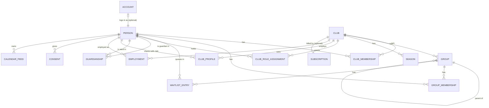

# Domain model (core)

This covers the core that everything else depends on: people, accounts, clubs,
groups, memberships, roles, guardianship, waiting lists and protected identity.
Feature modules (activities, chat, finance, …) document their own entities in
their prompts and extend this file.

## Key ideas

1. **A person exists once in the system.** One human = one `person` row, no
   matter how many clubs they belong to. Identified internally by a generated
   ID, never by email (ADR 0020).
2. **Email is the login, and only people who log in have one.** A login email
   is unique across the whole system. Children without a login have **no email
   at all**; their guardians are contacted instead.
3. **Everything a person *is* in a club is a relationship** with a validity
   period: membership, role, group function, employment, guardianship.
   Ending a relationship sets `valid_to`; history is kept (needed for LOK-stöd,
   annual reports, audit) until the retention period expires.
4. **Clubs see only what they need.** A club sees the person's profile fields
   that the person (or guardian) has shared with it.
5. **Groups, not just teams.** Clubs organise themselves differently: teams,
   training groups, age groups, sections, committees. All are `groups`
   (ADR 0019). The UI label is configurable per club and kind ("Lag",
   "Träningsgrupp", …).
6. **Protected identity overrides visibility everywhere** (ADR 0022). Every
   API response that mentions a person goes through one visibility service.

## Entity overview

## Entities

### `people` (global)
`id` (UUIDv7), `given_name`, `family_name`, `birth_date` (age rules: LOK,
child protection, consent age; unknown for people who signed up themselves
until onboarding asks, P1.1), `gender` (optional, some grant reports),
`personal_identity_number` (optional, encrypted, country-specific format,
stored as `<country>:<normalised number>` ciphertext),
`personal_identity_number_hash` (keyed blind index for finding duplicates),
`protected_identity` (bool, see below), `phone`, `address` (both optional;
address is never stored for protected persons, check constraint),
`deceased_at`, `anonymized_at`, `merged_into_person_id` (set on a merged
duplicate), `created_by_person_id`.
**No email column.** Email belongs to the account.

### `accounts` (global, optional per person)
Login identity: `person_id` (unique), `email` (unique, case-insensitive,
stored normalised: trimmed, lower-case), `email_verified_at`, `idp_subject`,
`locale`, `time_zone`, `theme`, `notification_settings`.
No password data (that lives in Zitadel).
- One account per person, one person per account.
- Changing email requires verifying the new address; the old address is
  notified.
- A guardian's email can never be attached to a child: uniqueness makes this
  impossible, and there is no "contact email" field on persons to put it in.

### Children without login, and giving them one later
- A guardian adds a child via **"Add child"**: name, birth date, optional
  personal identity number. This creates a `person` with no account and a
  `guardianship` (`kind = parent`) to the creator.
- The second guardian is **invited by email** to become guardian; they accept
  with their own account. A club manager or registrar can also confirm or add
  guardianships (e.g. from a paper application).
- The second guardian's invitation is a `guardian_invitations` row
  (`ward_person_id`, `invited_by_person_id`, `email`, `token_hash`, `kind`,
  `rights`, `expires_at`, `accepted_at`, `accepted_by_person_id`,
  `guardianship_id`, `revoked_at`); accepting creates the guardianship.
- Duplicates (both parents created the same child) are merged by a guardian
  of both, or by a club manager for two members of their club; matching on
  birth date + name or personal identity number. Merges are audited and
  reversible for 30 days (`people_merges`: kept and merged person, who
  merged, `undo_until`, `undone_at`, and every moved or ended reference).
  The duplicate's relationships move to the kept person; where the kept
  person already has the same open relationship, the duplicate's is ended.
  The duplicate stays as a stub with `merged_into_person_id`. A person with a
  login cannot be merged away (merge into them instead). A club manager's
  merge only moves rows in clubs the manager can see ([#5](https://github.com/SweRavn/ClubAdmin/issues/5)).
- **"Give own login"**: when the child reaches `own_account_min_age` (country
  pack, default 13), a guardian (or the club) enters the child's own email. An
  invitation goes to that address; when the child completes sign-up, the
  account is linked to the existing person — all history, memberships and
  groups are kept. The invitation is an `account_invitations` row
  (`person_id`, `email`, `token_hash`, `created_by_person_id`, `expires_at`,
  `accepted_at`, `revoked_at`); the account must be created with that
  (verified) email. Guardians keep their rights until `adult_age`; then the
  young person decides which guardian access continues.
- Messages for a child without account go to guardians with
  `receive_messages`.

### `clubs`
`id`, `name`, `short_name`, `slug`, `country`, `default_locale`, `time_zone`,
`currency`, `organization_number`, `federation_ids` (JSON, e.g. IdrottOnline),
`address`, `logo`, `status` (active, suspended, archived), `join_policy`,
`next_member_number` (for the per-club running member number),
`owners_can_appoint_co_owners` (default off), `group_owners_admit_to_club`
(default on).

### `club_profiles`
What a club sees about a person: **member number** (running number per club,
human-friendly, shown on lists and exports; assigned by a trigger under the
club row's lock), `shared_fields` (which of the person's own fields, such as
phone or address, the club may see), `emergency_contacts`, `notes`
(restricted), `protected_identity_club` (club-set protection flag, see
below). Photo and other consents are rows in `consents`. The profile is
created with the first membership and kept when the person leaves.

### `club_memberships`
Person ↔ club. `status` (active, paused, left; `applied` is legacy, no
longer written, see below), `membership_type` (active, supporting, honorary,
family), `valid_from`, `valid_to` (set exactly when `status = left`). Joining
follows `join_policy`: `open` → active at once, `approval` → a join request
the club decides, `invite_only` → only by invitation. Leaving also ends the
person's group memberships, ownerships and roles in the club. Registrars and
club managers pause, resume and end memberships and change their type in the
member register (P1.2, `PATCH /clubs/:clubId/members/:personId/membership`);
ending one on an earlier day sets `valid_to` to the end of that day in the
club's time zone (its groups and roles end at once), and the last club
manager's membership cannot end.

### The member register (P1.2)
`app.register_entries` lists, per club, everyone who is or was a member, with
their current membership (or their last, if they left); `applied` is never
listed. It joins people only through the club's memberships and profiles
(tenant row-level security), and its `visible` column is the database
backstop for protected identity: pages contain only rows the viewer may see;
counts may include protected members without identity (not for a name
search, which would reveal them). Search matches part of "given family" name
(trigram index) or the member number. Filters: status (default active and
paused), membership type, group, club role, birth year range, gender (only if
shared with the club), missing consent. Access (`registerAccess`): **full**
for club managers and registrars (every field the profile shows them, plus
roles and missing consents; protected members marked), **limited** for the
board roles `chair`, `vice_chair`, `treasurer`, `secretary`, `board_member`,
`deputy_board_member` (name, member number, membership type, groups; only
the name, type and group filters; never protected members).

### `member_exports`
A CSV export of the register (club-owned): `requested_by_person_id`, `status`
(queued, ready, failed, expired), `filter` (the register filter: IDs and enum
values only), `columns`, `include_protected`, `row_count`, `object_key`
(`exports/<club_id>/<id>.csv` in the files bucket), `expires_at` (24 hours
after it is ready), `error_code`. The insert trigger queues the worker job
(`members:export`), which writes the file in batches to object storage in the
requester's language (UTF-8 with byte order mark, formulas neutralised,
protected members only when included, then marked "do not share") and fails
the export if the requester has lost the role. Only the requester downloads
it (a pre-signed link valid five minutes); `members:expire_exports` deletes
the file after 24 hours and keeps the row as a record.

### `groups` (ADR 0019)
`id`, `club_id`, `parent_group_id` (optional hierarchy: section → team), `kind`
(`section`, `team`, `training_group`, `age_group`, `committee`, `board`,
`volunteers`, `other`), `name`, `sport`, `birth_year_from/to`,
`gender_category`, `level`, `capacity` (optional),
`admission_mode` (`direct` | `waitlist` | `closed`), `waitlist_visible_publicly`,
`offer_reply_days` (default 7), `archived_at`.
Groups persist across seasons; `seasons` (`name`, `starts_on`, `ends_on`)
and `group_seasons` (`capacity`, `notes`) hold per-season settings. Groups are
archived, never deleted.
Multi-sport sections are groups of kind `section`; the earlier
`section_admin` role is simply an owner of a section group.

### `group_memberships`
Person ↔ group with a **function**: `member` (player/participant),
`head_coach`, `assistant_coach`, `team_manager`, `physio`, `other_leader`.
A person can hold several functions in the same group (separate rows).
`valid_from`/`valid_to`.

### `group_owners`
Person ↔ group, administrative ownership: edit the group, manage its members
and functions, run its waiting list, manage its chat rooms and calendar.
- A group can have **several owners** (or none; club managers can always act).
- **Club managers assign and remove group owners.** Club setting
  `owners_can_appoint_co_owners` (default off) lets owners add co-owners.
- Ownership of a parent group (e.g. a section) includes its child groups.
- Ownership is independent of being a coach: often the same person, not always.
- `group_owners`: `group_id`, `person_id`, `assigned_by_person_id`,
  `valid_from`, `valid_to`.

### Waiting lists (ADR 0019)
`group_waitlist_entries`: `group_id`, `person_id`, `requested_by_person_id`
(e.g. guardian), `status` (`waiting`, `offered`, `accepted`, `declined`,
`expired`, `admitted`, `withdrawn`, `removed`), `queued_at`,
`priority` (optional: e.g. sibling, returning member), `offer_expires_at`,
`applicant_note`, `owner_note` (owners only), `out_of_order_reason`,
`decided_by_person_id`, `decided_at`. (Schema since P0.5; behaviour P1.10.)
- **Getting on the list:** a member (or guardian for a child) applies to a
  group that is full or has `admission_mode = waitlist`. Non-members can join a
  waiting list from the club's public page after signing up; this also creates
  a club join request.
- **Order:** priority, then `queued_at`. Applicants see their own position
  ("you are number 3"); owners see the full list with filters (birth year,
  gender category, waiting time).
- **Admitting:** an owner either admits directly or sends an **offer** that the
  person/guardian accepts or declines within `offer_reply_days`. Expired
  offers move on automatically to the next person if the owner enabled
  auto-offers.
- Admission creates the group membership and, if the person is not yet a club
  member, the club membership (club setting `group_owners_admit_to_club`,
  default on; otherwise a manager/registrar approves).
- **Fairness:** admitting someone out of order requires a reason, which is
  audited and visible to club managers.
- A person can be on several waiting lists at once.
- Closed entries are deleted after 12 months (retention).

### `club_role_assignments`
Club-level roles: `chair`, `vice_chair`, `treasurer`, `secretary`,
`board_member`, `deputy_board_member`, `auditor`, `nomination_committee`,
`club_manager`, `registrar` (membership/LOK), `safeguarding_officer`,
`communications`, `staff`. Validity period; `assigned_by_person_id`,
`ended_by_person_id`.

**Club managers** (ADR 0018) have full administrative rights in the club. A club
can have several; there must always be at least one active manager. The person
who creates a club becomes its first manager. Managers appoint/remove other
managers; handing over is "appoint successor → successor accepts → step down".
Proposals are `club_manager_handovers` (`from_person_id`, `to_person_id`,
`status`: proposed, accepted, declined, cancelled; `expires_at`, 14 days);
one open proposal per manager, a new one replaces it. Accepting makes the
successor manager and ends the proposer's role in one transaction.

### Sign-up and joining (ADR 0018, ADR 0032; P1.1)
- Anyone can sign up (verified email) without an invitation; this creates an
  `account` + `person` with no club yet. Before any club action the person
  completes their profile (birth date, for age rules; `PUT /me/profile`).
- `clubs.join_policy`: `open` | `approval` (default) | `invite_only`.
  `invite_only` clubs are not listed in the club search and answer "not
  found" to join requests.
- `join_requests` are **the only record of an application**: a person (and
  optionally their children, as a guardian with `act_on_behalf`) asks to
  join, with status `pending`/`approved`/`rejected`/`withdrawn`, decided by a
  manager or registrar (later also by a group owner admitting from a waiting
  list, P1.10). Approving creates the active membership in the same
  transaction; accepting an invitation settles a pending request. Columns:
  `person_id`, `requested_by_person_id`, `message`, `preferred_group_ids`
  (a hint; the web form does not offer them yet, as outsiders cannot see a
  club's groups), `decided_by_person_id`, `decided_at`, `decision_message`.
  Migration 0007 turned the old `applied` memberships into pending requests.
- `invitations`: email, link or code invitations with group and role presets
  (role presets only by club managers), expiry and use limit (`kind`,
  `email`, `token_hash`, `role_preset`, `group_id`, `expires_at`,
  `max_uses`, `uses`, `accepted_by_person_id` (first acceptance),
  `revoked_at`). Only a hash of the secret is stored; email tokens are
  derived from the invitation ID (ADR 0032). `invitation_acceptances`
  records everyone who accepted a link or code.
- Club creation is governed by `CLUB_CREATION` (`open` | `approval` |
  `operators_only`; default open when hosted, operators only when
  self-hosted). With `approval`, `club_creation_requests` (global: the
  requester and platform operators; the club fields, `status`,
  `decided_by_person_id`, `decided_at`, `decision_message`,
  `created_club_id`) are decided by an operator; approving creates the club
  with the requester as its first manager.
- `club_manager_reassignments`: an operator appointing a manager on the
  club's documented request, with the reason (recovery, ADR 0018).
- Decided join requests and invitations that can no longer be used are
  deleted after 12 months (worker `joining:retention`, `docs/gdpr.md`).
- Not yet: abandoned-club handling ([#16](https://github.com/SweRavn/ClubAdmin/issues/16)),
  challenges and per-domain limits against abuse ([#15](https://github.com/SweRavn/ClubAdmin/issues/15)),
  mobile screens ([#17](https://github.com/SweRavn/ClubAdmin/issues/17)).

### `guardianships` (global, confirmed per club)
`guardian_person_id`, `ward_person_id`, `kind` (`parent`, `legal_guardian`,
`relative`, `contact_person`), `rights` (flags: `act_on_behalf`,
`receive_messages`, `view_schedule`, `sign_up`, `see_medical`), `status`
(`pending`, `active`, `ended`; invitations are separate rows, see above),
`valid_from`, `valid_to`, `created_by_person_id`, `ward_adult_flagged_at`
(set by the worker when the ward reaches `adult_age`; the guardianship is
not ended automatically; the worker currently uses the highest `adult_age` of
all country packs, [#6](https://github.com/SweRavn/ClubAdmin/issues/6)).
- `parent`/`legal_guardian` default to full rights.
- `relative` (grandparent, older sibling) defaults to view-only and must be
  granted by a guardian.
- A guardianship becomes visible to a club only when the ward is a member of
  that club.
- Two guardians in separate households are both full guardians; neither can
  remove the other (only a club manager with evidence, audited). A guardian
  can end their own guardianship and those of relatives they granted.

### Protected identity (ADR 0022)
For people with protected personal data (in Sweden *skyddade
personuppgifter*: sekretessmarkering, skyddad folkbokföring), and anyone else
who must not be exposed.
- **Effective flag** = `people.protected_identity` (set by the person, or by a
  guardian for a child; applies in all clubs) **or**
  `club_profiles.protected_identity_club` (set by a club manager when the club
  has been informed; applies in that club).
- Only the person/guardian (global flag) or a club manager (club flag) can
  remove it; every change is audited and notifies club managers.
- **Who can see a protected person:** the person, their family (guardians and
  wards), club managers, registrars, and the owners (including owners of parent
  groups) and leaders of groups the person belongs to (they must run
  activities and take attendance). They see a **camera-with-strike-through
  icon** next to the name, meaning: do not photograph, film, publish or share.
  Platform operators with support access never see them.
- **Everyone else sees nothing:** not in member lists, group rosters,
  attendance/response lists, event participant lists, car pools, search,
  history/audit actor names, chat member lists, photos or streams. Counts may
  include them ("12 attending") without identity.
- **Chat and other shared spaces:** never added automatically. They (or their
  guardian) get an invitation and appear only in rooms they explicitly accept,
  optionally under a chosen display name.
- **Data minimisation:** no postal address stored; no public profile; never
  in public pages, streams, photo galleries or sponsor material; excluded from
  exports to other members. Federation exports (e.g. LOK-stöd) follow the
  country pack's rules for protected persons.
- **Guardians of a protected child** are prompted to protect themselves too
  (a parent's name can reveal the child).
- **Access logging:** every view of a protected person's profile is logged.

### `employments`
Person employed by a club: `title`, `starts_on`/`ends_on`, `employment_type`
(permanent, fixed_term, hourly, volunteer_stipend), `hours_per_week`. Salary data
lives in the `staff` module (later phase) with stricter access.

### `consents`
Purpose-based consents (photo/video publication, streaming, marketing, data
sharing with federation). Given by the person or, for minors under the
country's consent age, by a guardian. Timestamped, versioned text, revocable
(`purpose`, `text_version`, `given_by_person_id`, `given_at`, `revoked_at`,
`revoked_by_person_id`; one open consent per purpose).

### `calendar_feeds` (ADR 0021)
Personal, secret, revocable iCalendar subscription URLs: `person_id`, `scope`
(`my_schedule` incl. children, `group`, `club_public`), `scope_id`,
`token_hash`, `include_children`, `last_fetched_at`, `revoked_at`.

### Record history (ADR 0017)
Every table has a trigger writing to `history.record_changes`: table, record
id, operation, changed columns with old/new values, actor, on-behalf-of,
request id, time. Every detail screen can show "who changed what, when".
Separate from `audit_events`, which record business-level actions. Actor names
pass through the visibility service, so protected persons appear as
"Protected member" to those not allowed to see them.

### Platform tables
`platform_operators` (`person_id`, validity; written only by operator
tooling), `support_access_grants` (club-owned: `operator_person_id`,
`granted_by_person_id`, `reason`, `expires_at`, `revoked_at`; time-limited,
club-approved access for support, P0.7), `subscriptions`, `plans`,
`invoices` (billing module, optional), `feature_flags`.

## Access in the database (ADR 0023)

Row-level security backs the authorization module: club-owned tables are
isolated by `club_id`; a person's own relationships (and their wards') are
readable in every club; `people`, `accounts` and `guardianships` are reachable
only by the person, their family and the clubs they belong to.

## Effective permissions (examples)

| Situation | Can |
|---|---|
| Owner of group G | Edit G, manage members and functions, run G's waiting list, manage G's chat rooms and calendar |
| `head_coach` of group G | Edit G's activities, take attendance, message G's members and their guardians, see contact details of G's members (including protected members, with icon) |
| `member` in G, age 15 with account | See G's schedule, respond, join G's chat rooms; sees other members except protected ones |
| `parent` of member P | Everything P can do, on P's behalf; add children; plus guardian-only rooms |
| `relative` of P with `view_schedule` | See P's schedule only |
| `treasurer` of club C | Club finance, fees; with MFA |
| `board_member` of C | Board documents, meetings; member list (limited fields) |
| `safeguarding_officer` / `club_manager` | Background-check status of leaders; with MFA |
| `club_manager` of C | Everything in C's administration: settings, roles (incl. other managers and group owners), members, join requests, waiting lists, history; with MFA |
| Signed-up person without club | Own profile, add children, search clubs, send join requests, join waiting lists, create a club (if allowed) |
| Platform operator | Nothing in club data, unless the club grants time-limited support access |

## Permissions (implemented policies)

The authorization module (ADR 0006, ADR 0025) has one policy per permission
(`packages/shared/src/permissions.ts`, policies in
`apps/api/src/modules/authorization/authorization.policy.ts`). "Insider" means
any current relationship with the club: active or paused member, a club role,
a current employment, unexpired support access (operators, with a second
factor), or guardian of an active or paused member. Without one, everything in
the club answers 404; with one but without the permission, 403. "Owner"
includes owners of parent groups; "leader" is any function except `member`.

| Permission | Resource | Allowed for |
|---|---|---|
| `club.read` | club | insiders |
| `club.settings.update` | club | club managers, with MFA |
| `club.roles.manage` | club | club managers, with MFA |
| `club.members.read` | club | the member register (P1.2): club managers and registrars (full), the board roles (limited); see "The member register" |
| `club.members.manage` | club | registrars; club managers with MFA (pause, resume, end, change type) |
| `club.members.export` | club | club managers and registrars, with MFA and a login in the last 15 minutes |
| `group.read` | group | insiders; archived groups only managers, registrars and owners |
| `group.update` | group | club managers, owners |
| `group.owners.manage` | group | club managers; owners if the club allows co-owners |
| `group.members.read` | group | managers, registrars, owners; for active groups also everyone in the group, guardians (with `act_on_behalf`) of its members, support access |
| `group.members.manage` | group | club managers, owners |
| `person.profile.read` | person (`?clubId`) | the person and their guardians with `act_on_behalf`; in the club: managers and registrars, owners and leaders of the person's groups, and (unless the person is protected) people in the same group, their guardians, support access |
| `person.profile.update` | person | the person, guardians with `act_on_behalf` |
| `person.protection.set` | person | global flag: the person, guardians with `act_on_behalf` (the service requires a parent or legal guardian); club flag (`?clubId`): club managers, with MFA |
| `ops.backup.read` | platform (the installation, no IDs) | platform operators (in a self-hosted installation its administrators), with MFA: `GET /api/v1/ops/backup-status` |
| `club.access_state.update` | club | platform operators, with MFA (read-only and suspended clubs, also with billing off) |
| `billing.plans.read` | platform | platform operators, with MFA (billing on only) |
| `billing.subscription.read` | club | club managers and treasurers; platform operators with MFA (billing on only) |
| `billing.subscription.manage` | club | platform operators, with MFA (billing on only) |
| `club.create` | platform | anyone logged in with `CLUB_CREATION` `open` or `approval` (then a request); only platform operators, with MFA, with `operators_only`. The service also requires a verified email and a completed profile |
| `club.creation.decide` | platform | platform operators, with MFA |
| `club.join_requests.manage` | club | club managers, registrars |
| `club.invitations.manage` | club | club managers, registrars (a role preset also needs `club.roles.manage`) |
| `club.handover.respond` | handover | the proposed successor (accept, decline) and the proposer (cancel); nobody else learns that it exists |
| `club.managers.claim` | club | the board chair, with MFA, when the club has no active manager |
| `club.managers.reassign` | club | platform operators, with MFA (reason recorded; no access to club data) |

Endpoints for "my" data (`/me`, `/me/clubs`, `/me/groups`, `/me/wards`,
`/me/preferences`, `/me/profile`, `/me/join-requests`,
`/me/club-creation-requests`, `/me/manager-handovers`) need only a login, as
do the club search, asking to join (the service checks each person is the
caller or a ward with `act_on_behalf`) and accepting an invitation; looking
up an invitation by its link or code is public. Appointing, removing and
handing over managers use `club.roles.manage`. `GET /me/clubs` lists, per club, the
club-level permissions the caller holds (for navigation; permissions that need
a second factor are listed without one, the endpoints still ask for it).
A guardian acting for a ward (`X-On-Behalf-Of`) is evaluated as the ward,
with the ward's memberships only (never their roles, ownerships, leader
functions or employments); history and audit record both.

### Field visibility

`GET /api/v1/people/:personId?clubId=` returns fields by relationship
(`profileAccess`). Phone, address and gender reach a club only if the person
shared them with it (`club_profiles.shared_fields`).

| Viewer | Fields |
|---|---|
| The person, guardian with `act_on_behalf` | everything: birth date, gender, phone, address, club profile (member number, membership, groups), guardians with phone numbers |
| Club manager, registrar | birth date; shared phone, gender and address; member number, membership, groups; guardians with phone numbers |
| Owner or leader of one of the person's groups | birth date, shared phone, member number, groups, guardians with phone numbers |
| Same group, their guardians, support access | name only (never a protected person) |

## Age and child-safety rules (configured per country pack)

- `consent_age` (SE: 13) for data processing based on consent.
- `own_account_min_age` (default 13) — younger children have no login and no email.
- `adult_age` (18) — guardians' default rights end.
- Chat: no one-to-one chat between an adult and a minor unless a guardian is a
  participant; leaders can moderate group rooms.
