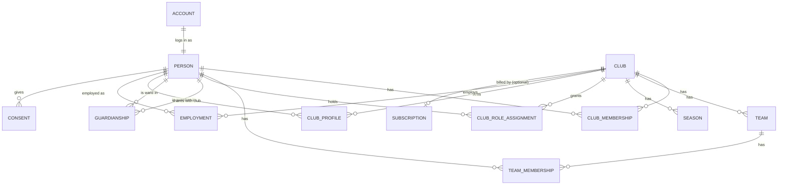

# Domain model (core)

This covers the core that everything else depends on: people, accounts, clubs,
teams, memberships, roles and guardianship. Feature modules (activities, chat,
finance, …) document their own entities in their prompts and extend this file.

## Key ideas

1. **A person exists once in the system.** One human = one `person` row, no
   matter how many clubs they belong to.
2. **A person may have no login.** Young children are persons without an
   `account`; their guardians act for them.
3. **Everything a person *is* in a club is a relationship** with a validity
   period: membership, role, team function, employment, guardianship.
   Ending a relationship sets `valid_to`; history is kept (needed for LOK-stöd,
   annual reports, audit) until the retention period expires.
4. **Clubs see only what they need.** A club sees the person's profile fields
   that the person (or guardian) has shared with it; contact details are not
   automatically shared across clubs.

## Entity overview

## Entities

### `accounts` (global)
Login identity. Links an IdP subject (`idp_subject`) to a `person_id`. One
account per person. Holds UI preferences (`locale`, `time_zone`, theme),
notification settings. No password data (that lives in the IdP).

### `people` (global)
`id`, `given_name`, `family_name`, `birth_date` (needed for age rules: LOK,
child protection, consent age), `gender` (optional, needed for some grant
reports; nullable), `personal_identity_number` (optional, encrypted,
country-specific format), `deceased_at`, `anonymized_at`.
Primary contact (email, phone, address) belongs to the person, but each club
sees it only through `club_profiles`.

### `clubs`
`id`, `name`, `short_name`, `slug`, `country`, `default_locale`, `time_zone`,
`currency`, `organization_number`, `federation_ids` (JSON: e.g. RF/IdrottOnline
id), `address`, `logo`, `status` (active, suspended, archived).
A club may have **sections** (multi-sport clubs: football, floorball) modelled
as `club_sections`; teams belong to a section.

### `club_profiles`
What a club sees about a person: contact details shared with that club, member
number, emergency contacts, notes (restricted), photo-consent flags. Created
when a membership is created. Deleting the membership schedules deletion of the
profile after the retention period.

### `club_memberships`
Person ↔ club. `status` (applied, active, paused, left), `membership_type`
(active, supporting, honorary, family), `valid_from`, `valid_to`.

### `teams` and `seasons`
Teams belong to a club (and optionally a section). `name`, `sport`,
`birth_year_from/to` or `age_group`, `gender_category`, `level`.
Teams persist across seasons; `team_seasons` holds per-season settings.

### `team_memberships`
Person ↔ team with a **function**: `player`, `head_coach`, `assistant_coach`,
`team_manager`, `physio`, `other_leader`. A person can hold several functions
in the same team (separate rows). `valid_from`/`valid_to`.

### `club_role_assignments`
Club-level roles: `chair`, `vice_chair`, `treasurer`, `secretary`,
`board_member`, `deputy_board_member`, `auditor`, `nomination_committee`,
`club_manager`, `section_admin`, `registrar` (membership/LOK), `safeguarding_officer`,
`communications`, `staff`. Optional scope to a section. Validity period.

**Club managers** (ADR 0018) have full administrative rights in the club. A club
can have several; there must always be at least one active manager. The person
who creates a club becomes its first manager. Managers appoint/remove other
managers; handing over is "appoint successor → successor accepts → step down".

### Sign-up and joining (ADR 0018)
- Anyone can sign up (verified email) without an invitation; this creates an
  `account` + `person` with no club yet.
- `clubs.join_policy`: `open` | `approval` (default) | `invite_only`.
- `join_requests`: person (and optionally their children) asking to join,
  with status `pending`/`approved`/`rejected`/`withdrawn`, decided by a manager
  or registrar.
- `invitations`: email or link/code invitations with role/team presets and expiry.
- Club creation is governed by `CLUB_CREATION` (`open` | `approval` |
  `operators_only`).

### `guardianships` (global, confirmed per club)
`guardian_person_id`, `ward_person_id`, `kind` (`parent`, `legal_guardian`,
`relative`, `contact_person`), `rights` (flags: `act_on_behalf`,
`receive_messages`, `view_schedule`, `sign_up`, `see_medical`), `valid_to`
(e.g. when the ward turns 18 the default parental rights end and the ward
decides).
- `parent`/`legal_guardian` default to full rights.
- `relative` (grandparent, older sibling) defaults to view-only and must be
  granted by a guardian.
- A guardianship becomes visible to a club only when the ward is a member of
  that club.
- Two guardians in separate households are both full guardians; neither can
  remove the other (only a club manager with evidence, audited).

### `employments`
Person employed by a club: role, start/end, employment type, hours. Salary data
lives in the `staff` module (later phase) with stricter access.

### `consents`
Purpose-based consents (photo/video publication, streaming, marketing, data
sharing with federation). Given by the person or, for minors under the
country's consent age, by a guardian. Timestamped, versioned text, revocable.

### Record history (ADR 0017)
Every table has a trigger writing to `history.record_changes`: table, record
id, operation, changed columns with old/new values, actor, on-behalf-of,
request id, time. Every detail screen can show "who changed what, when".
Separate from `audit_events`, which record business-level actions.

### Platform tables
`platform_operators`, `support_access_grants` (time-limited, club-approved
access for support), `subscriptions`, `plans`, `invoices` (billing module,
optional), `feature_flags`.

## Effective permissions (examples)

| Situation | Can |
|---|---|
| `head_coach` of team T | Edit T's activities, take attendance, message T's players and their guardians, see contact details of T's members |
| `player` in T, age 15 with account | See T's schedule, respond, join T's chat rooms |
| `parent` of player P | Everything P can do, on P's behalf; plus guardian-only rooms |
| `relative` of P with `view_schedule` | See P's schedule only |
| `treasurer` of club C | Club finance, fees; with MFA |
| `board_member` of C | Board documents, meetings; member list (limited fields) |
| `safeguarding_officer` / `club_manager` | Background-check status of leaders; with MFA |
| `club_manager` of C | Everything in C's administration: settings, roles (incl. other managers), members, join requests, history; with MFA |
| Signed-up person without club | Own profile, search clubs, send join requests, create a club (if allowed) |
| Platform operator | Nothing in club data, unless the club grants time-limited support access |

## Age and child-safety rules (configured per country pack)

- `consent_age` (SE: 13) for data processing based on consent.
- `own_account_min_age` (default 13) — younger children have no login.
- `adult_age` (18) — guardians' default rights end.
- Chat: no one-to-one chat between an adult and a minor unless a guardian is a
  participant; leaders can moderate team rooms.
