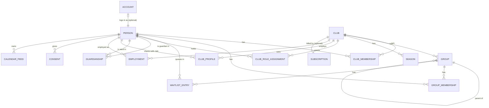

# Domain model (core)

This covers the core that everything else depends on: people, accounts, clubs,
groups, memberships, roles, guardianship, waiting lists and protected identity.
Feature modules (activities, chat, finance, …) document their own entities in
their prompts and extend this file.

## Key ideas

1. **A person exists once in the system.** One human = one `person` row, no
   matter how many clubs they belong to. Identified internally by a generated
   ID, never by email (ADR 0020).
2. **Email is the login, and only people who log in have one.** A login email
   is unique across the whole system. Children without a login have **no email
   at all**; their guardians are contacted instead.
3. **Everything a person *is* in a club is a relationship** with a validity
   period: membership, role, group function, employment, guardianship.
   Ending a relationship sets `valid_to`; history is kept (needed for LOK-stöd,
   annual reports, audit) until the retention period expires.
4. **Clubs see only what they need.** A club sees the person's profile fields
   that the person (or guardian) has shared with it.
5. **Groups, not just teams.** Clubs organise themselves differently: teams,
   training groups, age groups, sections, committees. All are `groups`
   (ADR 0019). The UI label is configurable per club and kind ("Lag",
   "Träningsgrupp", …).
6. **Protected identity overrides visibility everywhere** (ADR 0022). Every
   API response that mentions a person goes through one visibility service.

## Entity overview

## Entities

### `people` (global)
`id` (UUIDv7), `given_name`, `family_name`, `birth_date` (age rules: LOK,
child protection, consent age), `gender` (optional, some grant reports),
`personal_identity_number` (optional, encrypted, country-specific format),
`protected_identity` (bool, see below), `phone`, `address` (both optional;
address is never stored for protected persons), `deceased_at`,
`anonymized_at`, `created_by_person_id`.
**No email column.** Email belongs to the account.

### `accounts` (global, optional per person)
Login identity: `person_id` (unique), `email` (unique, case-insensitive,
verified), `idp_subject`, `locale`, `time_zone`, theme, notification settings.
No password data (that lives in Zitadel).
- One account per person, one person per account.
- Changing email requires verifying the new address; the old address is
  notified.
- A guardian's email can never be attached to a child: uniqueness makes this
  impossible, and there is no "contact email" field on persons to put it in.

### Children without login, and giving them one later
- A guardian adds a child via **"Add child"**: name, birth date, optional
  personal identity number. This creates a `person` with no account and a
  `guardianship` (`kind = parent`) to the creator.
- The second guardian is **invited by email** to become guardian; they accept
  with their own account. A club manager or registrar can also confirm or add
  guardianships (e.g. from a paper application).
- Duplicates (both parents created the same child) are merged by a guardian
  confirming the match, or by a club manager; matching on birth date + name or
  personal identity number. Merges are audited and reversible for 30 days.
- **"Give own login"**: when the child reaches `own_account_min_age` (country
  pack, default 13), a guardian (or the club) enters the child's own email. An
  invitation goes to that address; when the child completes sign-up, the
  account is linked to the existing person — all history, memberships and
  groups are kept. Guardians keep their rights until `adult_age`; then the
  young person decides which guardian access continues.
- Messages for a child without account go to guardians with
  `receive_messages`.

### `clubs`
`id`, `name`, `short_name`, `slug`, `country`, `default_locale`, `time_zone`,
`currency`, `organization_number`, `federation_ids` (JSON, e.g. IdrottOnline),
`address`, `logo`, `status` (active, suspended, archived), `join_policy`,
`next_member_number` (for the per-club running member number).

### `club_profiles`
What a club sees about a person: **member number** (running number per club,
human-friendly, shown on lists and exports), contact details shared with that
club, emergency contacts, notes (restricted), photo-consent flags,
`protected_identity_club` (club-set protection flag, see below).

### `club_memberships`
Person ↔ club. `status` (applied, active, paused, left), `membership_type`
(active, supporting, honorary, family), `valid_from`, `valid_to`.

### `groups` (ADR 0019)
`id`, `club_id`, `parent_group_id` (optional hierarchy: section → team), `kind`
(`section`, `team`, `training_group`, `age_group`, `committee`, `board`,
`volunteers`, `other`), `name`, `sport`, `birth_year_from/to`,
`gender_category`, `level`, `capacity` (optional),
`admission_mode` (`direct` | `waitlist` | `closed`), `waitlist_visible_publicly`,
`offer_reply_days` (default 7), `archived_at`.
Groups persist across seasons; `group_seasons` holds per-season settings.
Multi-sport sections are groups of kind `section`; the earlier
`section_admin` role is simply an owner of a section group.

### `group_memberships`
Person ↔ group with a **function**: `member` (player/participant),
`head_coach`, `assistant_coach`, `team_manager`, `physio`, `other_leader`.
A person can hold several functions in the same group (separate rows).
`valid_from`/`valid_to`.

### `group_owners`
Person ↔ group, administrative ownership: edit the group, manage its members
and functions, run its waiting list, manage its chat rooms and calendar.
- A group can have **several owners** (or none; club managers can always act).
- **Club managers assign and remove group owners.** Club setting
  `owners_can_appoint_co_owners` (default off) lets owners add co-owners.
- Ownership of a parent group (e.g. a section) includes its child groups.
- Ownership is independent of being a coach: often the same person, not always.

### Waiting lists (ADR 0019)
`group_waitlist_entries`: `group_id`, `person_id`, `requested_by_person_id`
(e.g. guardian), `status` (`waiting`, `offered`, `accepted`, `declined`,
`expired`, `admitted`, `withdrawn`, `removed`), `queued_at`,
`priority` (optional: e.g. sibling, returning member), `offer_expires_at`,
`applicant_note`, `owner_note` (owners only), `decided_by_person_id`.
- **Getting on the list:** a member (or guardian for a child) applies to a
  group that is full or has `admission_mode = waitlist`. Non-members can join a
  waiting list from the club's public page after signing up; this also creates
  a club join request.
- **Order:** priority, then `queued_at`. Applicants see their own position
  ("you are number 3"); owners see the full list with filters (birth year,
  gender category, waiting time).
- **Admitting:** an owner either admits directly or sends an **offer** that the
  person/guardian accepts or declines within `offer_reply_days`. Expired
  offers move on automatically to the next person if the owner enabled
  auto-offers.
- Admission creates the group membership and, if the person is not yet a club
  member, the club membership (club setting `group_owners_admit_to_club`,
  default on; otherwise a manager/registrar approves).
- **Fairness:** admitting someone out of order requires a reason, which is
  audited and visible to club managers.
- A person can be on several waiting lists at once.
- Closed entries are deleted after 12 months (retention).

### `club_role_assignments`
Club-level roles: `chair`, `vice_chair`, `treasurer`, `secretary`,
`board_member`, `deputy_board_member`, `auditor`, `nomination_committee`,
`club_manager`, `registrar` (membership/LOK), `safeguarding_officer`,
`communications`, `staff`. Validity period.

**Club managers** (ADR 0018) have full administrative rights in the club. A club
can have several; there must always be at least one active manager. The person
who creates a club becomes its first manager. Managers appoint/remove other
managers; handing over is "appoint successor → successor accepts → step down".

### Sign-up and joining (ADR 0018)
- Anyone can sign up (verified email) without an invitation; this creates an
  `account` + `person` with no club yet.
- `clubs.join_policy`: `open` | `approval` (default) | `invite_only`.
- `join_requests`: person (and optionally their children) asking to join,
  with status `pending`/`approved`/`rejected`/`withdrawn`, decided by a manager
  or registrar (or implicitly by a group owner admitting from a waiting list).
- `invitations`: email or link/code invitations with role/group presets and expiry.
- Club creation is governed by `CLUB_CREATION` (`open` | `approval` |
  `operators_only`).

### `guardianships` (global, confirmed per club)
`guardian_person_id`, `ward_person_id`, `kind` (`parent`, `legal_guardian`,
`relative`, `contact_person`), `rights` (flags: `act_on_behalf`,
`receive_messages`, `view_schedule`, `sign_up`, `see_medical`), `status`
(`pending` invitation, `active`), `valid_to`.
- `parent`/`legal_guardian` default to full rights.
- `relative` (grandparent, older sibling) defaults to view-only and must be
  granted by a guardian.
- A guardianship becomes visible to a club only when the ward is a member of
  that club.
- Two guardians in separate households are both full guardians; neither can
  remove the other (only a club manager with evidence, audited).

### Protected identity (ADR 0022)
For people with protected personal data (in Sweden *skyddade
personuppgifter*: sekretessmarkering, skyddad folkbokföring), and anyone else
who must not be exposed.
- **Effective flag** = `people.protected_identity` (set by the person, or by a
  guardian for a child; applies in all clubs) **or**
  `club_profiles.protected_identity_club` (set by a club manager when the club
  has been informed; applies in that club).
- Only the person/guardian (global flag) or a club manager (club flag) can
  remove it; every change is audited and notifies club managers.
- **Who can see a protected person:** club managers, registrars, and the
  owners/leaders of groups the person belongs to (they must run activities and
  take attendance). They see a **camera-with-strike-through icon** next to the
  name, meaning: do not photograph, film, publish or share.
- **Everyone else sees nothing:** not in member lists, group rosters,
  attendance/response lists, event participant lists, car pools, search,
  history/audit actor names, chat member lists, photos or streams. Counts may
  include them ("12 attending") without identity.
- **Chat and other shared spaces:** never added automatically. They (or their
  guardian) get an invitation and appear only in rooms they explicitly accept,
  optionally under a chosen display name.
- **Data minimisation:** no postal address stored; no public profile; never
  in public pages, streams, photo galleries or sponsor material; excluded from
  exports to other members. Federation exports (e.g. LOK-stöd) follow the
  country pack's rules for protected persons.
- **Guardians of a protected child** are prompted to protect themselves too
  (a parent's name can reveal the child).
- **Access logging:** every view of a protected person's profile is logged.

### `employments`
Person employed by a club: role, start/end, employment type, hours. Salary data
lives in the `staff` module (later phase) with stricter access.

### `consents`
Purpose-based consents (photo/video publication, streaming, marketing, data
sharing with federation). Given by the person or, for minors under the
country's consent age, by a guardian. Timestamped, versioned text, revocable.

### `calendar_feeds` (ADR 0021)
Personal, secret, revocable iCalendar subscription URLs: `person_id`, `scope`
(`my_schedule` incl. children, `group`, `club_public`), `scope_id`,
`token_hash`, `include_children`, `last_fetched_at`, `revoked_at`.

### Record history (ADR 0017)
Every table has a trigger writing to `history.record_changes`: table, record
id, operation, changed columns with old/new values, actor, on-behalf-of,
request id, time. Every detail screen can show "who changed what, when".
Separate from `audit_events`, which record business-level actions. Actor names
pass through the visibility service, so protected persons appear as
"Protected member" to those not allowed to see them.

### Platform tables
`platform_operators`, `support_access_grants` (time-limited, club-approved
access for support), `subscriptions`, `plans`, `invoices` (billing module,
optional), `feature_flags`.

## Effective permissions (examples)

| Situation | Can |
|---|---|
| Owner of group G | Edit G, manage members and functions, run G's waiting list, manage G's chat rooms and calendar |
| `head_coach` of group G | Edit G's activities, take attendance, message G's members and their guardians, see contact details of G's members (including protected members, with icon) |
| `member` in G, age 15 with account | See G's schedule, respond, join G's chat rooms; sees other members except protected ones |
| `parent` of member P | Everything P can do, on P's behalf; add children; plus guardian-only rooms |
| `relative` of P with `view_schedule` | See P's schedule only |
| `treasurer` of club C | Club finance, fees; with MFA |
| `board_member` of C | Board documents, meetings; member list (limited fields) |
| `safeguarding_officer` / `club_manager` | Background-check status of leaders; with MFA |
| `club_manager` of C | Everything in C's administration: settings, roles (incl. other managers and group owners), members, join requests, waiting lists, history; with MFA |
| Signed-up person without club | Own profile, add children, search clubs, send join requests, join waiting lists, create a club (if allowed) |
| Platform operator | Nothing in club data, unless the club grants time-limited support access |

## Age and child-safety rules (configured per country pack)

- `consent_age` (SE: 13) for data processing based on consent.
- `own_account_min_age` (default 13) — younger children have no login and no email.
- `adult_age` (18) — guardians' default rights end.
- Chat: no one-to-one chat between an adult and a minor unless a guardian is a
  participant; leaders can moderate group rooms.
